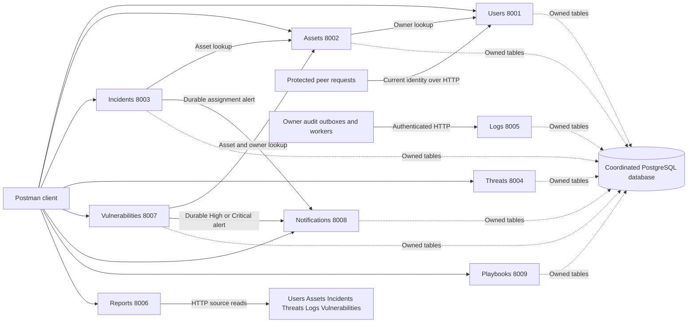

# Security Incident Detection and Response Management System

EECE 435L Software Tools Lab — Sprint I

Natalio Hassoun · Chris Gharfine · Karim Hajj Ali

This backend helps a security team record incidents, track affected assets and
vulnerabilities, assign investigations, send notifications, retain audit records,
and organize response actions. Reports combine information from the services so
administrators and auditors can review the same underlying security activity.
Sprint I provides REST APIs, PostgreSQL storage, authentication, validation and
Postman tests. It does not require a graphical frontend.

The merged `main` branch contains all nine services. Each service runs as its own
HTTP process. The services share a coordinated PostgreSQL database for relational
integrity, while each implementation owns its tables and uses HTTP to obtain
another service's business data. The current shared contract is
[team integration v1.1](docs/team/INTEGRATION_V1_1.md).

## Start here

1. Follow [setup and database migration instructions](docs/team/SETUP.md).
   They include Python dependencies, private configuration, migration order,
   all nine startup commands, delivery workers, and test commands.
2. Follow the [API workflow and examples](docs/team/WORKFLOW.md) to sign in,
   register an asset, assign an incident, observe notifications and audit
   delivery, and read reports.
3. Import the [current Postman collections](#postman-collections). Use local
   variables for credentials and tokens, then run the requests in dependency
   order with disposable demonstration records.
4. Read [verification and screenshot guidance](docs/team/EVIDENCE.md) to
   distinguish recorded test execution, live integration, and report evidence.

## Service ownership and addresses

Append the route prefix and resource path to the origin. For example,
Users login is `http://127.0.0.1:8001/api/natalio-hassoun/users/login`.

| Service | Responsible student | Port | Route prefix | Main responsibility |
|---|---|---:|---|---|
| 1 Users | Natalio Hassoun | 8001 | `/api/natalio-hassoun` | Accounts, login, profiles and current identity |
| 2 Assets | Chris Gharfine | 8002 | `/api/chris-gharfine` | Asset inventory and validated owner references |
| 3 Incidents | Karim Hajj Ali | 8003 | `/api/karim-hajj-ali` | Registration, assignment, status and notes |
| 4 Threat Intelligence | Chris Gharfine | 8004 | `/api/chris-gharfine` | Validated threat indicators and searches |
| 5 Logs | Natalio Hassoun | 8005 | `/api/natalio-hassoun` | Audit ingestion, retrieval and filtering |
| 6 Reports | Chris Gharfine | 8006 | `/api/chris-gharfine` | Six reports assembled from source APIs |
| 7 Vulnerabilities | Karim Hajj Ali | 8007 | `/api/karim-hajj-ali` | CVE, CVSS, severity and asset-linked tracking |
| 8 Notifications | Karim Hajj Ali | 8008 | `/api/karim-hajj-ali` | Recipient inboxes and reliable internal delivery |
| 9 Playbooks | Natalio Hassoun | 8009 | `/api/natalio-hassoun` | Ordered response actions and action history |

See [contributions and commit evidence](docs/team/CONTRIBUTIONS.md) for source
directories, personal branches and representative commits. These are
responsibility assignments; a commit count is not a workload measurement.

## Local setup overview

Use Python 3.12 and an existing PostgreSQL installation. From the repository
root in PowerShell:

```powershell
py -3.12 -m venv .venv-team
.\.venv-team\Scripts\python.exe -m pip install -r requirements.txt
```

Create a new private `.env.team` from `.env.example` and fill its placeholders
locally, following [the configuration steps](docs/team/SETUP.md#2-private-configuration).
Keep an existing private file instead of copying over it. Runtime database URLs
must point to the same team database; test URLs must point to separate dedicated
test databases. Coordinate one JWT secret and matching per-service keys.

Apply migrations in this order: **Natalio → Chris → Karim**. Users must exist
before Assets; both must exist before Incidents and Vulnerabilities. Start the
nine HTTP processes and delivery workers using the exact commands in setup.
Bootstrap an initial administrator only if one is not already present. Changing
`.env.team` does not update an existing account's password.

## How the services work together



The diagram groups repeated identity and audit connections for readability.
Every protected peer request verifies its JWT locally and consults Users for
the current account status and role. Service keys authenticate internal calls;
they do not replace user permissions. Outbox records persist delivery work
through dependency outages. UUID receipts prevent duplicate audit records and
notifications when a worker retries a delivery.

## Postman collections

| Owner | Current collection | Environment |
|---|---|---|
| Natalio | [Users, Logs and Playbooks](postman/Student1.postman_collection.json) | [Local template](postman/Local.postman_environment.json) |
| Chris | [Assets, Threats and Reports](postman/chris-sprint1.postman_collection.json) | Configure collection variables using [Chris's guide](docs/chris/service-guide.md) |
| Karim | [Incidents](postman/Service%203%20-%20Incident%20Management.postman_collection.json), [Vulnerabilities](postman/Service%207%20-%20Vulnerability%20Management.postman_collection.json), [Notifications](postman/Service%208%20-%20Notification%20Management.postman_collection.json) | [SIRMS v1 local template](postman/SIRMS%20v1%20Local.postman_environment.json) |

Import the templates, choose the correct environment, set real credentials in
local variables, and send Administrator login first. Check all nine health
endpoints before running the complete workflow. Four successful login/health
requests alone do not demonstrate the services' CRUD operations or permissions.
Saved material under `postman/historical/` predates the current route contract.

## Verification and evidence

The recorded 20 October integration run reported **520 passing pytest cases
and 79 passing subtests**, plus a separate **128-check scenario using nine real
HTTP services**. Some owner suites use explicitly identified upstream doubles;
those results alone do not demonstrate live team integration. Counts overlap
and must not be added together as a unique test total.

Read [the execution record](docs/team/VERIFICATION_V1_1.md), the
[evidence guide](docs/team/EVIDENCE.md), and the current
[integration status](INTEGRATION_STATUS.md). These are dated results, not a
claim that this repository runs continuous integration on every commit. Repeat
the documented checks after changing code or deployment configuration.

## Detailed documentation

- [API workflow and route index](docs/team/WORKFLOW.md)
- [Setup, migrations, workers and tests](docs/team/SETUP.md)
- [Shared authentication and HTTP contracts](docs/team/INTEGRATION_V1_1.md)
- [Natalio's guide](STUDENT1.md), [API reference](docs/API.md), and [database design](docs/DATABASE.md)
- [Chris's service guide](docs/chris/service-guide.md) and [verification notes](docs/chris/verification.md)
- [Karim's guide](docs/karim/START_HERE.md) and [Sphinx source index](docs/source/index.rst)
- [Contributors and workload](docs/team/CONTRIBUTIONS.md)
- [References and AI assistance](docs/team/REFERENCES.md)
- [CREATES feedback and documentation changes](docs/team/CREATES_FEEDBACK.md)

AI assistance supported implementation review, compatibility fixes, testing and
documentation preparation. The reference guide explains that scope. Each
student must review, understand and demonstrate their assigned implementation.
