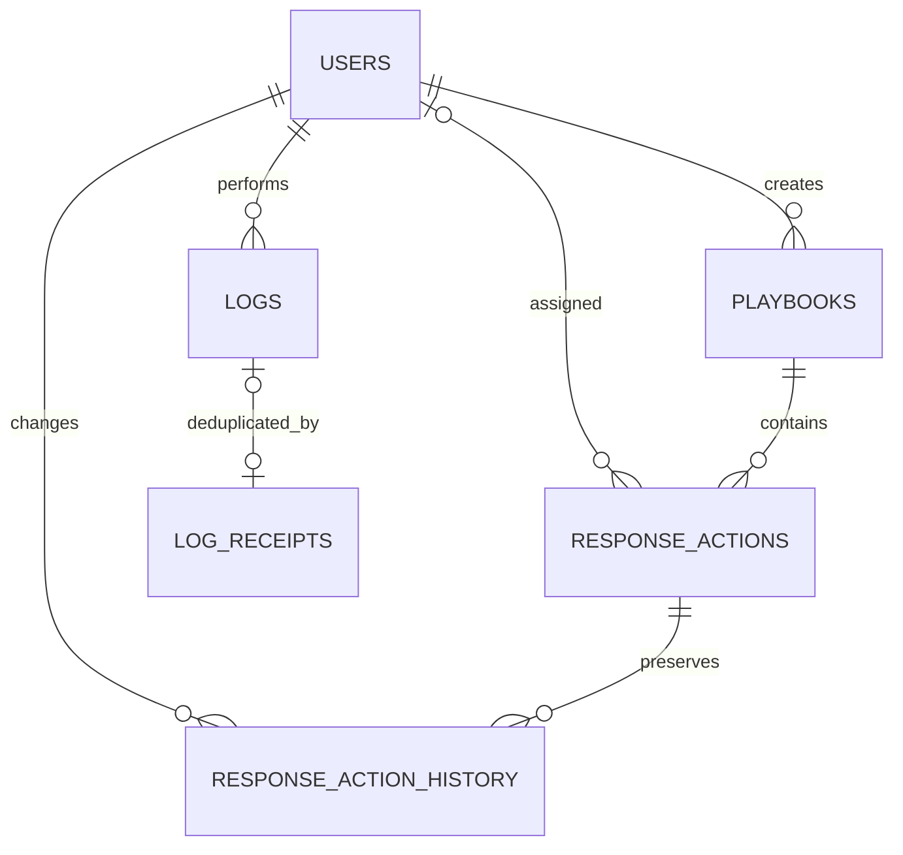

# Database design (Natalio Hassoun)

Users, Logs, Playbooks and Response Actions implement the assignment's owned core
entities. Response Action History, Log Receipts and the two outbox tables are
supporting additions. Exact SQL types/keys/checks/indexes appear in
`database/001_student1.sql`; models appear in `security_backend/models.py`.

| Table | Keys and relationships | Purpose and field groups |
|---|---|---|
| users | integer id PK; unique username/email | identity/profile, hash, role/status, creation/login/deletion dates |
| logs | integer id PK; nullable user_id FK users; unique event_id | actor/action/description, severity, related/source service, UTC timestamp |
| log_receipts | event_id PK; nullable log_id FK logs ON DELETE SET NULL | immutable event fingerprint/source, retry deduplication |
| playbooks | integer id PK; created_by FK users | name/description, category/severity, creation/deletion dates |
| response_actions | integer id PK; playbook_id FK playbooks; nullable assigned_user_id FK users; unique playbook/step | ordered description, status, completion_date, concurrency version |
| response_action_history | integer id PK; action_id FK actions; changed_by FK users | previous/current JSON snapshots and UTC timestamp |
| users_audit_outbox | UUID string PK | Users-owned event payload, created/delivered dates, attempt count, last error code |
| playbooks_audit_outbox | UUID string PK | Playbooks-owned event payload, created/delivered dates, attempt count, last error code |
| student1_schema_versions | version PK | applied migration marker and timestamp |

User FKs use RESTRICT rather than cascade to protect historical meaning. Soft
deleting users retains their IDs. Playbooks are also soft-deleted to preserve
action execution history. Database triggers reject updates to logs and both
updates/deletes to response_action_history. Administrator log deletion is an API
permission; application roles do not protect against a privileged database owner.

Check constraints enforce role/status/severity enums, positive action steps and
the consistency between Completed and completion_date. SQLAlchemy queries bind
values as parameters; raw string interpolation is not used for user input.
The test cleanup uses only internally generated schema names.

Logging and history store timezone-aware values. The API normalizes serialization
to UTC. No passwords are stored outside their salted hashes. No model serializer
returns password_hash. Sample passwords are supplied locally through environment
configuration, never committed as credentials.

The shared team schema also needs Assets, Incidents, Investigation Notes, Threats,
Vulnerabilities and Notifications. Those tables are intentionally not created
here. Coordinate user foreign keys and field names with their owners. Schema
consistency does not authorize direct cross-service application writes.

The initial script is non-destructive and repeatable, not a schema-diff engine.
For later changes add a new numbered migration, with a backup and review of its
effect on team relationships. Never edit a live shared database by dropping it.
