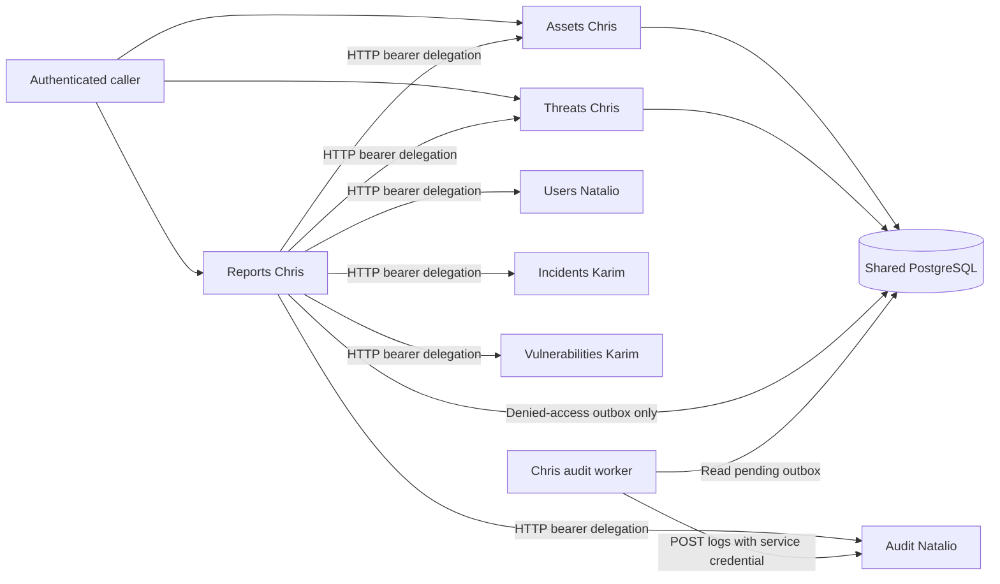
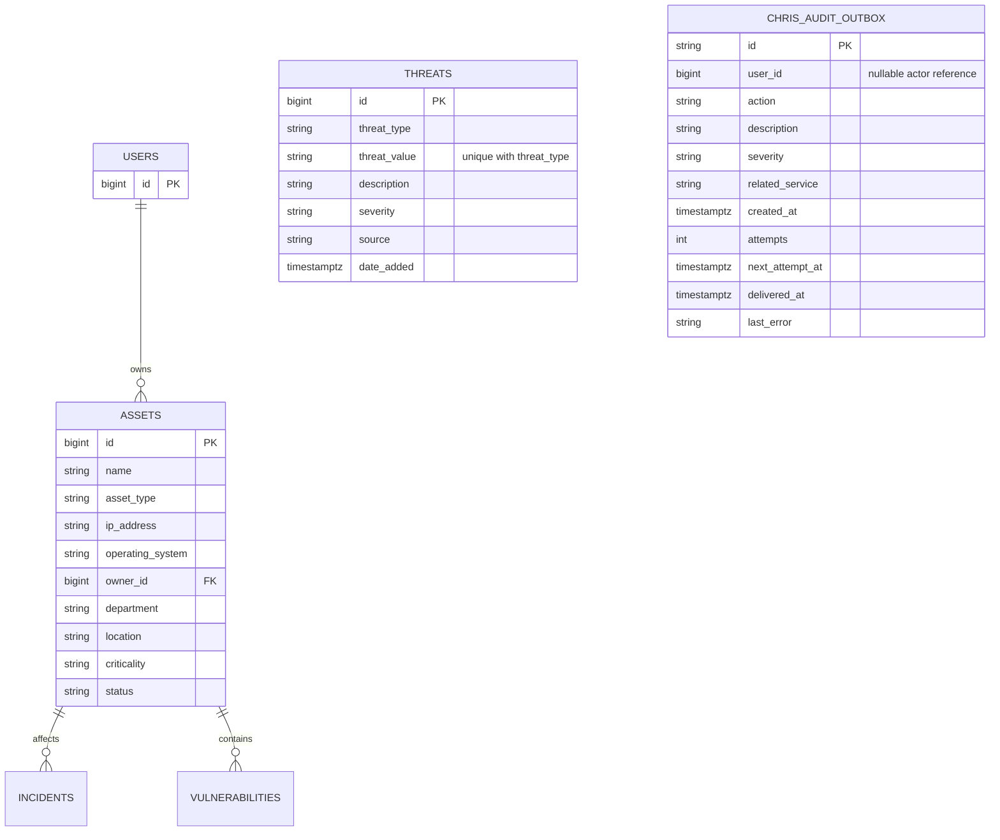

# Integration contracts and remaining work (Chris Gharfine)

These are the contracts implemented under Chris's user-approved baseline. They
remain proposals for Natalio's and Karim's actual services. Automated source
doubles validate Chris's adapters; they do not establish that the team already
implements these shapes. No external-service endpoint was invented to hide a
missing dependency.

## Architecture and database

Reports does not query another service's business tables. The shared database
exists for required referential integrity, not to replace HTTP service calls.

USERS/INCIDENTS/VULNERABILITIES are external entities shown for relationships only.
Chris owns neither their definitions nor their production migrations. Outbox
actor IDs intentionally have no user foreign key, so audit delivery records can
survive user deletion and record anonymous failed authentication.

## JWT contract with Natalio

- One configured trusted verification algorithm/key, issuer, and audience.
- Positive integer `sub` encoded as text; numeric `iat`/`exp` timestamps.
- `role` equal to a documented role string and `account_status` equal to `active`.
- No user-token issuance in Chris's services. Bearer tokens come from Users.
- Confirm claim names, role spellings, expiry policy, key rotation, account-status
  freshness, immediate suspension/revocation, and service-account token issuance.
- Analyst asset access currently follows the prescribed detail/search endpoint
  permissions. Related-incident scoping is unconfirmed because no relationship
  lookup contract exists in the assignment's prescribed APIs.

## Report HTTP contracts

The caller's bearer token is forwarded to a configured service base URL and the
following prescribed endpoint. Each response must be `200` JSON containing the
complete array. Record IDs must be unique positive integers. Additional fields
are ignored, while every field consumed by the report is validated.

| Source | Path | Required consumed fields |
| --- | --- | --- |
| Users | `GET /users` | `id` |
| Assets | `GET /assets` | `id`, `asset_type`, `criticality`, `status` |
| Incidents | `GET /incidents` | `id`, `severity`, `status` |
| Threats | `GET /threats` | Complete Threat object from Chris's contract, including `date_added` |
| Vulnerabilities | `GET /vulnerabilities` | `id`, `severity`, `status` |
| Audit | `GET /logs` | `id`, nullable `user_id`, `action`, `timestamp`, `severity`, `related_service` |

Use the snake_case enum spellings in the service guide. Incident states are
`open`, `under_investigation`, `mitigated`, `resolved`, `closed`. Vulnerability
states are `open`, `under_investigation`, `in_progress`, `resolved`, `closed`.
Audit severities are `information`, `warning`, `error`, `critical`. Timestamp
fields must be ISO strings with a timezone, not naive datetimes or numeric epochs.

User and source schemas must not expose credentials to reports; unneeded fields
are not returned by Chris's report responses. Counts derive from array contents;
unknown enum values, missing fields, duplicate IDs, invalid timestamps, envelopes,
and partial/paginated shapes are rejected with `502`. A paginated team contract
requires a deliberate adapter update that traverses all pages, not a silent
first-page approximation. Response bounds fail explicitly rather than truncate.

`CHRIS_HTTP_TIMEOUT_SECONDS` defaults to five per source request. Summary reads
four sources sequentially. `CHRIS_MAX_UPSTREAM_BYTES` defaults to 5,000,000 and
`CHRIS_MAX_UPSTREAM_RECORDS` to 50,000 per source. The client does not follow
redirects or use ambient HTTP proxies. A source's `401`/`403` is preserved;
timeouts/connection errors/`429`/server errors return `503`; unexpected statuses,
non-JSON content, and malformed source data return `502`. No report stores a copy
of the source business data.

`open_incidents` counts only literal `open`. Recent threats/activities use at most
ten records by default, sorted by timestamp descending and then ID descending.
Activity counts all returned audit entries. Login attempts count
`auth.login.succeeded` plus `auth.login.failed`; failures count the latter alone.
Configure different agreed actions with `CHRIS_LOGIN_SUCCESS_ACTION` and
`CHRIS_LOGIN_FAILURE_ACTION`. These action names require Natalio's confirmation.

## Audit-write contract with Natalio

The worker calls `POST /logs` with a separately configured service bearer token
and `Idempotency-Key` equal to the outbox event UUID. The JSON event fields are:

| Field | Meaning |
| --- | --- |
| `event_id` | Stable UUID string reused on retries |
| `user_id` | Actual authenticated actor ID; null when authentication failed |
| `action` | `assets.created/updated/deleted`, `threats.created/updated/deleted`, `authorization.denied`, or `authentication.denied` |
| `description` | Short operation/record description; no submitted body or token |
| `severity` | `information` for mutation events; `warning` for denied access |
| `related_service` | `assets`, `threats`, or `reports` |
| `timestamp` | Original timezone-aware event creation timestamp |

Success requires `200` or `201` with a JSON object containing a positive integer
`id`. Invalid acknowledgments, `202`, authorization failures, and outages leave
the event pending. Retries preserve the original event and increment attempts;
delay is exponential, capped at 300 seconds. Error diagnostics store a sanitized
status/reason rather than response bodies or credentials. Batch size defaults
to 50. Only delivered fields/attempt metadata change; original event data remains.

Natalio must confirm this extra `event_id`, nullable actor handling, original
timestamp preservation, service-call authorization, acknowledgment, and durable
idempotency behavior. An analyst's caller token cannot authorize administrator-
only log insertion. Do not start delivery with a fabricated admin token or modify
Natalio's implementation without approval. Until integrated, events are durably
queued locally but cannot be claimed as present in the Audit service.

## Integration completion checklist

- [ ] Natalio confirms JWT/key/status/revocation and service-token contracts.
- [ ] Natalio's actual Users migration precedes Assets, with compatible integer IDs.
- [ ] Karim confirms and creates restrictive asset foreign keys for Incidents and
      Vulnerabilities; confirm their field/enum names against report adapters.
- [ ] Confirm source URLs, network connectivity, full-array or pagination shape,
      and administrator/auditor access with real shared-identity tokens.
- [ ] Natalio confirms and exercises audit ingestion/deduplication, including
      denied analyst requests and anonymous authentication failures.
- [ ] Reconcile all six reports against records created by the real source APIs.
- [ ] Clarify student-name routing and auditor threat-search permission with the
      professor. Keep prescribed paths and the narrower Service 4 policy meanwhile.
- [ ] Capture actual Postman/database/commit evidence using Chris Gharfine captions.

No live checks above have been marked complete using automated test doubles.
